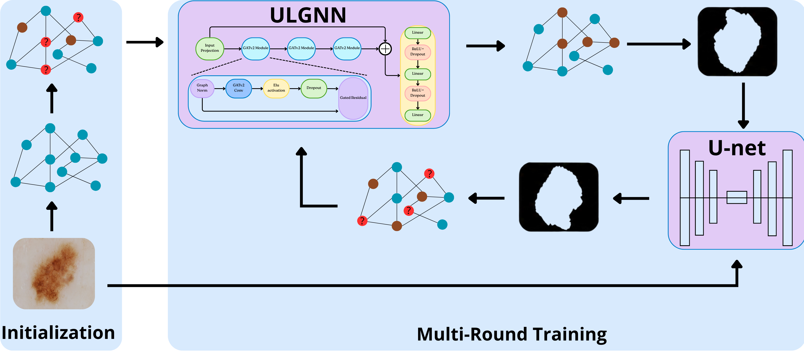
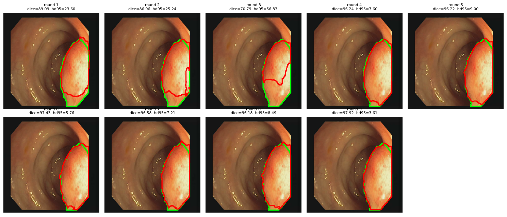
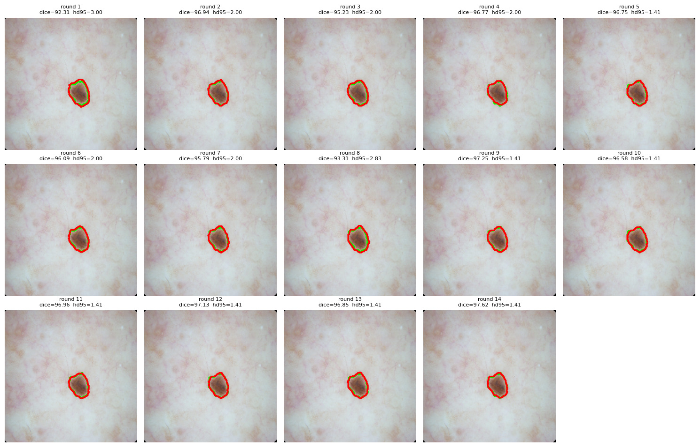
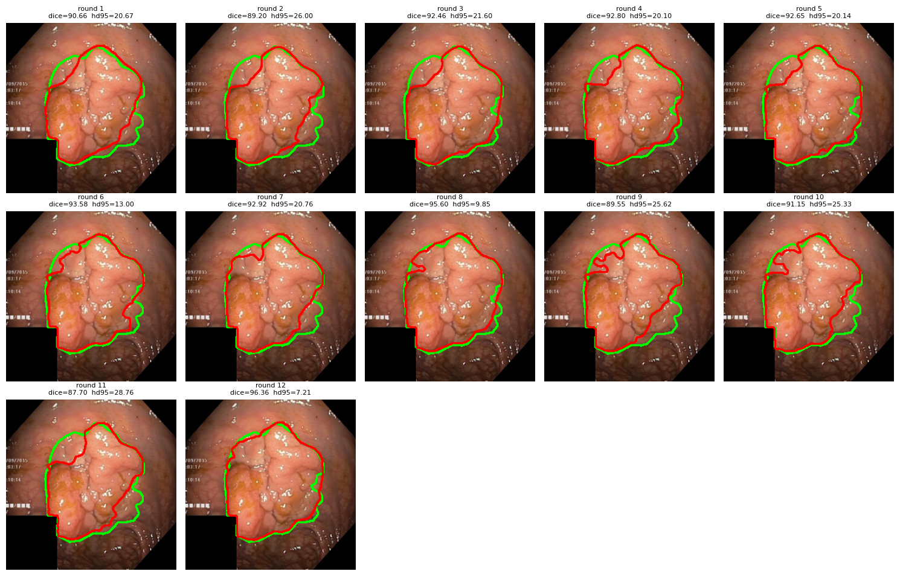
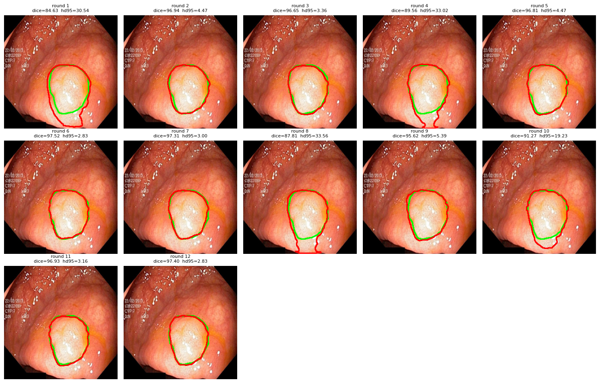
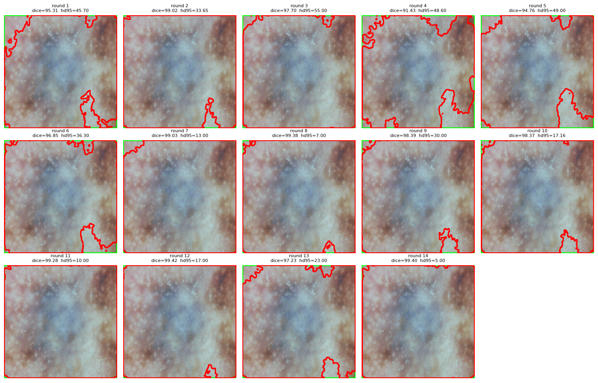

# ULGNN-An-Ultra-Lightweight-Graph-Neural-Network-for-Annotation-Free-Skin-Lesion-Segmentation

  

This repository is intended as supplementary material for the paper: ULGNN: An Ultra-Lightweight Graph Neural Network for Annotation-Free Skin Lesion Segmentation.

These images were added to illustrate the segmentation results across multiple rounds on different datasets. We present five examples, where the red contours represent the predicted segmentations and the green contours represent the ground-truth masks.

## Qualitative Results (You can click on the images to get a closer look at the segmentation results and performance across different rounds.)
### Additional images are available in the folders named after each dataset and can be viewed for further examples.

### Example 1 — CVC-ClinicDB (9 Rounds)

  

### Example 2 — ISIC17 (14 Rounds)

  

### Example 3 — Kvasir (12 Rounds)

  

### Example 4 — Kvasir (12 Rounds)

  

### Example 5 — ISIC16

  

